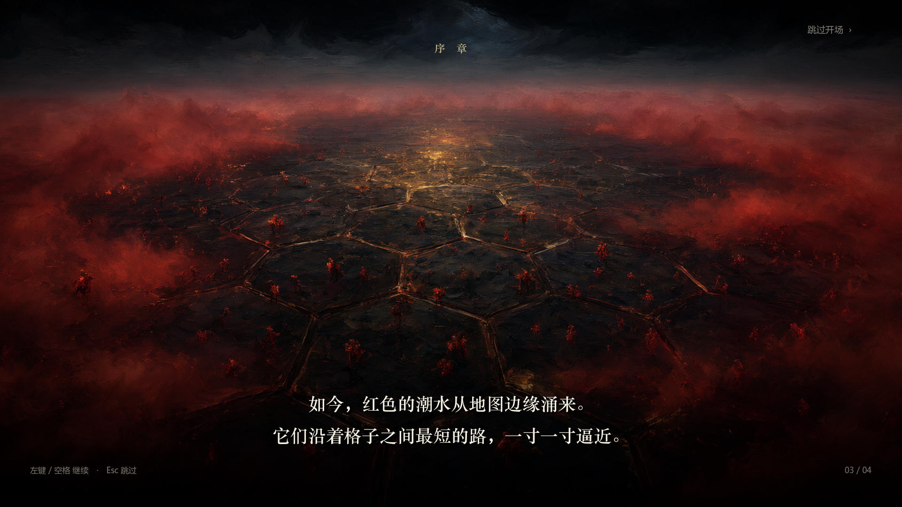
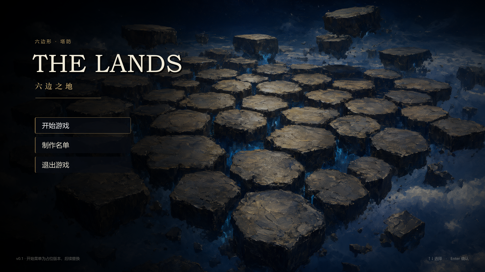

# 开屏动画与开始菜单

现在的启动流程：

```text
F5 → scenes/opening.tscn（四页开屏，底部字幕）
   → 淡出到黑 → scenes/main_menu.tscn（占位菜单）
   → 点「开始游戏」→ scenes/game.tscn
```

`project.godot` 里的主场景已经改成 `res://scenes/opening.tscn`。

## 先看效果







## 涉及的文件

| 文件 | 作用 |
| --- | --- |
| `scenes/opening.tscn` | 开屏画面：两层图片交叉淡入、字幕、暗角、跳过按钮 |
| `scripts/opening.gd` | 四页内容、打字机字幕、推镜、切页、去菜单 |
| `opening/*.png` | 开屏插画（16:9 左右最好） |
| `scenes/main_menu.tscn` | 占位开始菜单 |
| `scripts/main_menu.gd` | 开始游戏 / 制作名单 / 退出 |
| `shaders/vignette.gdshader` | 暗角 + 轻微胶片颗粒 |

VN（按 V 触发的剧情系统）没有被改动，开屏和它互不影响。

## 改开屏

### 改字幕 / 换图 / 调节奏

打开 `scripts/opening.gd`，只改顶部的 `PAGES`：

```gdscript
const PAGES := [
    {
        "image": "res://opening/01_whole_land.png",
        "text": "很久以前，大地是完整的一块。\n河流从山脊流向海，没有一个格子是孤岛。",
        "hold": 1.8,                 # 字打完后停留几秒
        "zoom": 1.075,               # 这一页缓慢推镜到多大
        "pan": Vector2(-14.0, -8.0), # 推镜时往哪边平移一点
    },
    ...
]
```

* 想加一页：往 `PAGES` 里再加一个 `{}`，把图片放进 `opening/`；
* 想删一页：删掉对应 `{}`，页码会自动变成 `xx / 总页数`；
* 换图保持 16:9 左右，`res://opening/` 下的文件名不要用中文以外需要转义的字符；
* 打字速度改 `CHAR_SECONDS`（默认 `0.045` 秒/字，越小越快）。

### 操作

* 左键 / 空格 / 回车：继续（打字中按下会立刻显示整句）；
* 右上角「跳过开场」或 `Esc`：直接去开始菜单；
* 播放完最后一页会自动淡出并进入菜单。

## 改开始菜单

现在是占位版：左侧标题 + 三个按钮，背景是第二张开屏图缓慢推镜。

* 按钮文字、位置：`scenes/main_menu.tscn` 的 `MenuButtons` 下面；
* 按钮样式：`SB_btn_normal` / `SB_btn_hover` / `SB_btn_pressed` 三个 `StyleBoxFlat`；
* 标题：`Title` / `TitleCn` / `Kicker` 三个 `Label`；
* 背景图：`scripts/main_menu.gd` 顶部的 `BACKGROUND`；
* 「制作名单」目前只弹一行占位提示，在 `_show_credits()` 里改。

## 主场景和 F5

`project.godot` 已经写好了：

```ini
[application]

run/main_scene="res://scenes/opening.tscn"
```

如果 Godot 编辑器在改主场景之前就一直开着，它可能还缓存着旧的主场景，按 F5 仍会进游戏。把项目关掉重新打开一次即可；也可以直接双击 `scenes/opening.tscn` 后按 **F6** 单独运行开屏。

## 已做的检查

* 无窗口启动通过，开屏脚本/场景没有解析错误；
* 1920×1080 下截了四页和菜单的图（就是上面的图）；
* 用脚本模拟点击「开始游戏」，确认能切到 `res://scenes/game.tscn`；
* 游戏里 `Esc` 已改为返回开始菜单（原来直接退出）。
