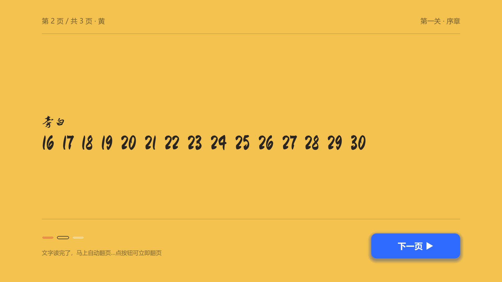
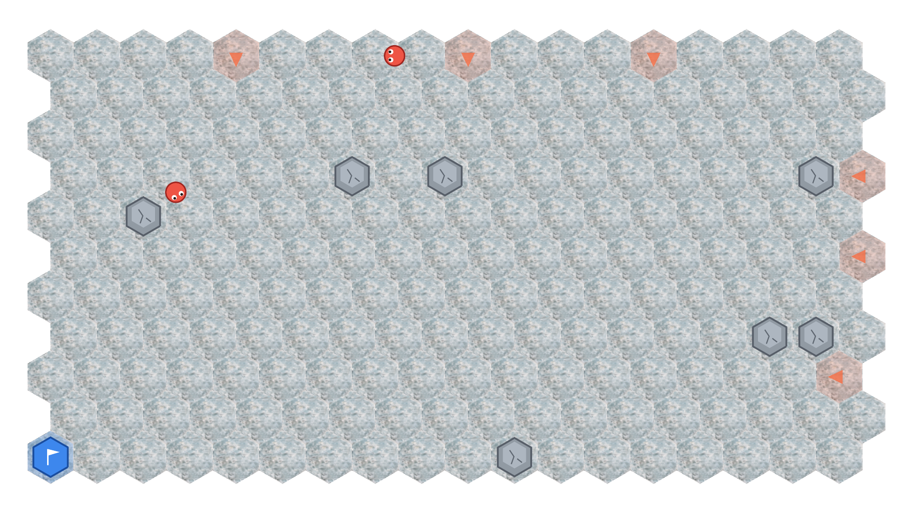

# 视觉小说使用教程

> 适用于本项目的 Godot 4.7 工程。看完这一篇，你就能在游戏的任何时刻弹出视觉小说，并且自己改剧情内容。
>
主菜单的「剧情试玩」读取 `vn/demo.json`。战斗中按 V 打开原有的 `vn/first_level.json`。下面的截图对应线性色页。

## 分支剧本与试玩

试玩用功能标签展示两条路线和一个共同结束页。文案可以复制 `vn/demo.json`，保留文件结构，再替换自己的内容。

| 页字段 | 播放行为 |
|---|---|
| `id` | 唯一页名。旧页省略时依次使用字符串 1、2、3。 |
| `background`、`portrait` | 可选的 `res://` 图片路径。只在本页显示，省略的图层会清空。 |
| `choices` | 数组，每项有按钮文字 `text` 和目标页名 `next`。正文显示完后等待玩家选择，自动模式也会等待。 |
| `next` | 普通页读完后的目标。省略则按数组顺序继续，`@end` 表示结束。 |

底部「自动」连续出字、翻页，再按一次转手动。「回看」只展示本次已读对白和选过的路线，回看期间暂停推进。「返回」关闭阅读并恢复来源场景。

文件剧本共用一个本地存档槽。打开同一剧本按「读档」恢复上次保存的页与阅读记录；出字途中保存会从该页开头再读。剧本文件更新后，旧档会提示版本不匹配。存档不记录战斗和菜单状态。通过字典临时打开的剧本支持阅读、选项和回看。

## 0. 先看效果

第 1 页（红）在点击蓝色按钮之前，整屏只有红色底色、页码、标题和右下角蓝色按钮（正文还没出现）：


点蓝色按钮后，文字逐字出现；文字读完后会自动翻到下一页：





三页读完后自动关闭，回到游戏：



---

## 1. 这次加了哪些文件

| 文件 | 作用 | 需要改吗 |
| --- | --- | --- |
| `vn/first_level.json` | **剧情内容**（标题、三页、颜色、台词） | ✅ 主要改这里 |
| `scripts/vn_manager.gd` | 全局单例 `VN`，负责打开 / 关闭 / 暂停游戏 | 一般不用 |
| `scenes/vn/vn_layer.tscn` | 小说画面（页面、按钮、排版） | 改外观时用 |
| `scripts/vn_layer.gd` | 翻页流程、打字机、自动翻页 | 改交互节奏时用 |
| `scripts/vn_story.gd` | 读取 JSON、检查格式、红黄白三色定义 | 改颜色时用 |
| `fonts/ZhiMangXing.ttf` | 正文和说话人使用的字体 | 换字体时替换 |
| `tools/vn_check.gd` | 一键自检：读剧本 → 出字 → 翻页 → 关闭 | 改完内容跑一下 |
| `tools/vn_preview.gd` | 自动截三页的图到 `docs/images/` | 可选 |

`scripts/game.gd` 和 `scenes/game.tscn` 里加了战斗入口：按 V 播放默认剧本。

`project.godot` 里注册了自动加载：

```ini
[autoload]

VN="*res://scripts/vn_manager.gd"
```

因为 `VN` 是 Autoload（全局单例），所以**任何场景、任何脚本、任何时刻**都能直接调用，不需要在场景里摆节点，也不需要信号连线。

---

## 2. 怎么调用

### 2.1 一行代码打开默认剧情

```gdscript
VN.open_file("res://vn/first_level.json")
```

或者省略路径（用默认的 `res://vn/first_level.json`）：

```gdscript
VN.open()
```

打开后：

* 小说层盖在所有 HUD 和场景之上；
* 默认会**暂停游戏**（敌人、计时、`_process` 全部停住）；
* 第 1 页先是纯色页面 + 蓝色按钮，玩家点按钮才出字；
* 文字显示完停留 1.6 秒自动翻下一页；
* 最后一页读完自动淡出，游戏恢复运行。

### 2.2 带参数调用

第二个参数是选项字典，全部可选：

```gdscript
VN.open_file("res://vn/first_level.json", {
    "pause": true,           # 打开时暂停游戏，默认 true
    "typewriter_speed": 30,  # 每秒出现多少字；0 = 瞬间全部出现，默认 30
    "auto_advance": true,    # 文字读完后自动翻页，默认 true
    "page_hold": 1.6         # 自动翻页前停留几秒，默认 1.6
})
```

常用的两种改法：

```gdscript
# 让玩家自己点“下一页”，不自动翻（更像传统视觉小说）
VN.open_file("res://vn/first_level.json", {"auto_advance": false})

# 文字出得慢一点 / 快一点
VN.open_file("res://vn/first_level.json", {"typewriter_speed": 18})
```

> 想改全局默认值，改 `scripts/vn_layer.gd` 顶部的
> `DEFAULT_TYPE_SPEED`（默认 30）和 `DEFAULT_PAGE_HOLD`（默认 1.6）。

### 2.3 不用文件，直接写在脚本里

适合很短的一次性台词：

```gdscript
VN.open({
    "title": "遭遇战",
    "pages": [
        {"color": "red", "speaker": "旁白", "text": "第一页的内容。"},
        {"color": "yellow", "speaker": "旁白", "text": "第二页的内容。"},
        {"color": "white", "speaker": "旁白", "text": "第三页的内容。"}
    ]
})
```

`VN.open()` 根据参数自动判断：`null` → 默认文件；字符串 → JSON 路径；字典 → 直接播放；`VnStory` 对象 → 直接播放。

### 2.4 在任意时刻触发

`VN` 是全局的，所以下面这些地方都能直接调：

```gdscript
# 1) 关卡开始播开场剧情（game.gd 的 _ready 末尾）
VN.open_file("res://vn/first_level.json")

# 2) 第 3 波敌人出现时播第二段
func _on_wave_started(wave: int) -> void:
    if wave == 3:
        VN.open_file("res://vn/chapter_02.json")

# 3) 玩家第一次让敌人到达基地
func _on_enemy_reached(enemy) -> void:
    if _reached == 1:
        VN.open_file("res://vn/first_loss.json")

# 4) 点自己的 UI 按钮
func _on_story_button_pressed() -> void:
    VN.open_file("res://vn/first_level.json")
```

不需要等场景切换，也不需要把小说节点放进关卡场景。`VN` 第一次被调用时会自己创建小说层。

### 2.5 播放结束 / 关闭之后做点什么

```gdscript
func _ready() -> void:
    VN.finished.connect(_on_vn_finished)  # 最后一页读完（还在淡出）
    VN.closed.connect(_on_vn_closed)      # 已经完全关闭，游戏已恢复
    VN.page_changed.connect(_on_vn_page)  # 翻到新的一页

func _on_vn_page(page_index: int, page_count: int) -> void:
    print("现在是第 %d / %d 页" % [page_index + 1, page_count])

func _on_vn_closed() -> void:
    print("剧情结束，继续游戏")
```

注意：

* **`finished`** 在最后一页读完时发出，此时还在淡出、游戏仍暂停；
* **`closed`** 在淡出完成、游戏恢复后发出。

所以「剧情结束后开始出怪 / 切场景 / 发奖励」建议接 `closed`，不要在 `finished` 里直接切场景。

只想听一次：

```gdscript
VN.closed.connect(_on_intro_done, CONNECT_ONE_SHOT)
```

### 2.6 中途关闭 / 查询状态

```gdscript
VN.close()            # 玩家按 Esc 也是走这里
print(VN.is_open)     # 正在播放吗
print(VN.current_page())  # 当前第几页，从 0 开始；没播放时是 -1
VN.advance()          # 等价于点一下蓝色按钮（做自动播放用）
```

> 如果打开时游戏已经被别的东西暂停了（比如暂停菜单），关闭后会保持原来的暂停状态，不会把暂停菜单也一起关掉。

---

## 3. 怎么编辑剧情内容

### 3.1 文件在哪

默认剧本：**`vn/first_level.json`**。

用任何文本编辑器（VS Code、记事本都行）打开就能改，保存后重新运行游戏即可，不需要在 Godot 里重新导入。

### 3.2 字段说明

最外层：

| 字段 | 类型 | 说明 |
| --- | --- | --- |
| `title` | 字符串 | 小说标题，显示在页面右上角；省略时用文件名 |
| `pages` | 数组 | 至少一页，按顺序播放 |

每一页：

| 字段 | 类型 | 说明 |
| --- | --- | --- |
| `color` | 字符串 | `red` / `yellow` / `white`，或自定义 `#RRGGBB` |
| `speaker` | 字符串 | 说话人，显示在正文上方；省略或 `""` 就不显示 |
| `text` | 字符串 | 这一页的文字，可以很长、可以用 `\n` 换行 |
| `lines` | 数组 | `text` 的另一种写法，数组元素会用换行拼成一段 |

三种颜色的实际色值：

| 写法 | 页面底色 | 文字颜色 |
| --- | --- | --- |
| `red` | `#D8453C` | 白色 |
| `yellow` | `#F2C14E` | 深色 |
| `white` | `#F7F5F1` | 深色 |

文字颜色会根据底色自动选深色或浅色；用 `#RRGGBB` 自定义底色时也会自动适配。

### 3.3 最小可运行例子

```json
{
  "title": "测试",
  "pages": [
    { "color": "red", "speaker": "旁白", "text": "1" },
    { "color": "yellow", "speaker": "旁白", "text": "2" },
    { "color": "white", "speaker": "旁白", "text": "3" }
  ]
}
```

### 3.4 换成正式台词

把 `text` 里的数字换成正文即可：

```json
{
  "title": "第一关 · 序章",
  "pages": [
    {
      "color": "red",
      "speaker": "旁白",
      "text": "潮水退下去的第三天，海面上浮起了一座不该存在的岛。"
    },
    {
      "color": "yellow",
      "speaker": "守卫",
      "text": "「别靠近那片雾。上一支队伍进去之后，就再也没回来。」"
    },
    {
      "color": "white",
      "speaker": "旁白",
      "text": "你握紧了手里的旗子。\n身后是最后一座塔，身前是整片海。"
    }
  ]
}
```

小提示：

* JSON 字符串里想换行，写 `\n`；
* 台词里用中文引号 `「」`，就不用转义英文双引号；
* 不要写 `//` 注释，JSON 不支持；也不要留多余的逗号。

### 3.5 加页 / 删页 / 换颜色

页数没有限制，`pages` 里多写一个对象就是多一页：

```json
{
  "color": "yellow",
  "speaker": "守卫",
  "text": "又一阵雾涌了上来。"
}
```

颜色可以重复（比如红、黄、白、红……），也可以自定义：

```json
{ "color": "#2F6BFF", "text": "这一页是自定义蓝色背景。" }
```

不过为了保持「红、黄、白表示三页」的辨识度，默认三页建议就用这三种。

### 3.6 一页里写多段

两种写法等价：

```json
{ "color": "red", "text": "第一段。\n第二段。" }
```

```json
{ "color": "red", "lines": ["第一段。", "第二段。"] }
```

注意：`lines` 只是排版上的换行，**不是「点一次出一行」**。这一页的所有文字会一起逐字出现，读完后翻下一页。

### 3.7 多段剧情分文件

复制一份 `first_level.json` 改成 `chapter_02.json`，放在同一个 `vn/` 目录，然后：

```gdscript
VN.open_file("res://vn/chapter_02.json")
```

或者放进别的子目录（路径仍然用 `res://` 开头）：

```gdscript
VN.open_file("res://vn/chapter_02/boss.json")
```

### 3.8 换掉默认剧情

改 `scripts/game.gd` 顶部：

```gdscript
const VN_STORY_PATH := "res://vn/first_level.json"
```

或者改 `scripts/vn_manager.gd` 里的 `DEFAULT_STORY_PATH`，这样 `VN.open()` 不带参数时也会用新文件。

### 3.9 一页写多少字合适

* 建议一页 1～3 句话（大约 20～60 个字），太长就拆成多页；
* 文字超过大约 5 行会被页面裁掉（页面正文区高度固定）；
* 按现在的默认节奏，一页的时长 ≈ `字数 ÷ 30 + 1.6` 秒；
* 台词多的时候，优先加页，而不是把一整段塞进一页。

---

## 4. 改外观和节奏

### 4.1 改三色

`scripts/vn_story.gd` 顶部：

```gdscript
const PAGE_COLORS := {
    "red": {"color": Color(0.847, 0.271, 0.235), "label": "红"},
    "yellow": {"color": Color(0.949, 0.757, 0.306), "label": "黄"},
    "white": {"color": Color(0.969, 0.961, 0.945), "label": "白"},
}
```

`label` 是页码后面显示的颜色名（「第 1 页 / 共 3 页 · 红」），不想要就改成 `""`。

### 4.2 改排版 / 字号 / 按钮

用 Godot 打开 `scenes/vn/vn_layer.tscn`：

* `PageFrame`：整页铺满游戏窗口（全屏）；想改留白/内容位置，调 `Page` 下各子节点的偏移；
* `Page/Content`：说话人 + 正文的区域（整块垂直居中）；
* `Page/ContinueButton`：右下角蓝色按钮；
* 蓝色按钮的颜色在 `SB_btn_normal` / `SB_btn_hover` / `SB_btn_pressed` 三个 `StyleBoxFlat` 里；
* 正文 / 说话人字体：`fonts/ZhiMangXing.ttf`，在 `scripts/vn_layer.gd` 的 `BODY_FONT_PATH` 里加载；
  换字体时把新 ttf 放进 `fonts/`，再改这个常量；
* 导出成品时 ttf 需要一起打包，`export_presets.cfg` 里已经加了 `include_filter="fonts/*.ttf,vn/*.json"`；
* 正文字号在 `vn_layer.tscn` 的 `Content/ContentCenter/Text`（76），说话人字号在 `SpeakerLabel`（52）；
* 页码 / 标题 / 底部提示 / 按钮仍然是 `SystemFont`（微软雅黑），换字体改 `font_names`。

### 4.3 改交互节奏

`scripts/vn_layer.gd` 顶部：

```gdscript
const DEFAULT_TYPE_SPEED := 30.0   # 每秒字数，0 = 瞬间
const DEFAULT_PAGE_HOLD := 1.6     # 读完后停留秒数
```

也可以每次调用时用 `typewriter_speed` / `page_hold` 临时覆盖。

### 4.4 操作方式

* 点右下角**蓝色按钮**：开始出字 / 显示全部 / 翻页 / 结束；
* 空格、回车：和点按钮一样；
* Esc：随时关闭，回到游戏。

---

## 5. 常见问题

**Q：控制台报 `视觉小说：找不到剧本文件`。**

路径写错了。路径必须以 `res://` 开头，并且是相对工程根目录的，比如 `res://vn/first_level.json`。注意大小写和扩展名。

**Q：控制台报 `第 3 行 JSON 语法错误`。**

JSON 格式问题：少逗号、多逗号、引号没配对、用了中文引号当语法引号。用 VS Code 打开会有红色波浪线；改完保存再运行。

**Q：点了蓝色按钮没反应。**

* 确认 `VN.is_open` 是 `true`；
* 确认没有别的东西盖在小说层上（小说层是 `CanvasLayer`，`layer = 100`）；
* 如果打开了 `pause: false`，游戏快捷键会被小说层吞掉，但不影响按钮。

**Q：文字不出现 / 一打开就已经有字。**

检查是不是用了旧版本；当前流程是「页面先空着，点按钮才出字」。如果给 `typewriter_speed` 传了 `0`，点一下就会瞬间全部出现。

**Q：为什么还没点按钮就翻页了？**

当前页读完会自动翻页，这是默认行为。想要点一下才翻，调用时传 `{"auto_advance": false}`。

**Q：最后一页之后游戏没恢复。**

关闭动画大约 0.18 秒；等 `VN.closed` 信号，或稍等一帧再继续。不要在 `VN.finished` 里立刻切场景。

**Q：文字被截断了。**

一页内容太长，超过正文区高度。拆成两页，或者调大 `vn_layer.tscn` 里 `Page/Content` 的高度 / 调小正文字号。

**Q：正文字体没生效，变成了默认雅黑。**

检查 `fonts/ZhiMangXing.ttf` 是否还在；加载失败时控制台会提示，并自动退回雅黑。换字体时同步改 `scripts/vn_layer.gd` 里的 `BODY_FONT_PATH`。

立绘与选项写法见开头的「分支剧本与试玩」。

---

## 6. 自检和截图

在项目根目录使用 Godot 4.7.2 可执行文件运行以下命令。第一次打开工程先等资源导入完成。

~~~sh
godot --headless --path . --script res://tools/vn_check.gd
godot --headless --path . --script res://tools/vn_framework_check.gd
~~~

旧样例应输出 VN_CHECK_OK；试玩检查覆盖菜单、分支、背景、立绘、回看、坏档和存档恢复，应输出 VN_FRAMEWORK_OK。两条命令分别使用三页样例和试玩数据。

重新生成线性教程的截图可运行：

~~~sh
godot --path . --windowed --resolution 1920x1080 --script res://tools/vn_preview.gd
~~~

图片会输出到 `docs/images/`。

---

## 7. 改动清单（方便你 review）

* 新增 `scripts/vn_manager.gd`（全局单例 `VN`）；
* 新增 `scripts/vn_story.gd`（JSON → 剧本对象，红黄白三色）；
* 新增 `scripts/vn_layer.gd` + `scenes/vn/vn_layer.tscn`（小说画面与流程）；
* 新增 `vn/first_level.json`（三页示例剧情，文字先用数字占位）；
* `project.godot` 注册 `VN` Autoload；
* 主菜单新增「剧情试玩」，战斗内保留 V 键；
* `scripts/game.gd` 新增 `VN_STORY_PATH`、`_open_vn()`、V 键入口；
* 新增 `tools/vn_check.gd`、`tools/vn_preview.gd`。
